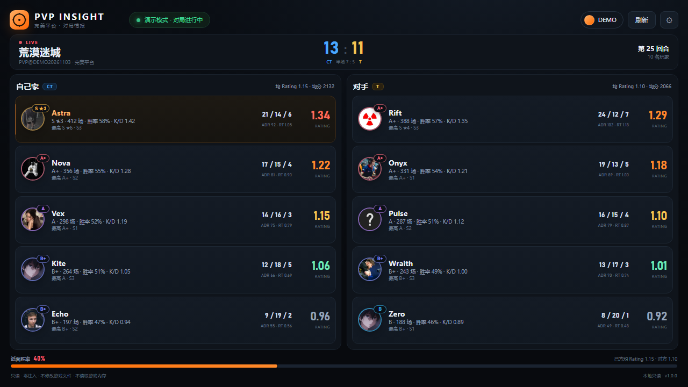
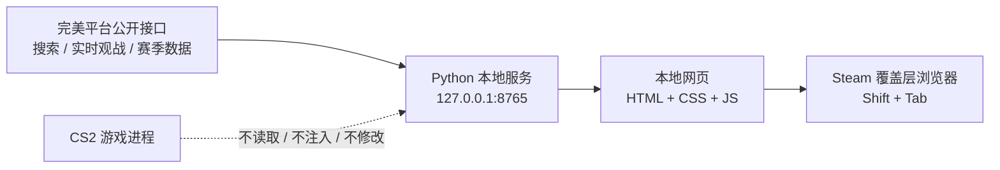

# PVP Insight

> 完美世界竞技平台（CS2）对局情报 · 本地网页版
>
> 在 **Steam 覆盖层浏览器** 里查看当前对局双方 10 名玩家的段位、Rating、最高段位、S 段星数与实时数据。

<p align="center">
  
</p>

<p align="center">
  
  
  
  
</p>



---

## ⚠️ 重要声明

> **本项目不承诺、也无法承诺“100% 不封号”。**
>
> 它没有注入进程、没有读取游戏内存、没有修改游戏文件、没有键鼠监听或模拟输入。游戏内使用的是 **Steam 自带的覆盖层浏览器**，后台只是一个监听 `127.0.0.1` 的本地网页服务。
>
> 但它仍然是一个第三方程序。平台用户协议、反作弊策略和人工处置都可能变化，**是否使用请自行判断，风险自担**。
>
> 如果要求字面意义上的 100%，唯一方案是不要在游戏电脑上运行任何第三方程序。

本项目与完美世界、Valve、Steam 均无关联，也不是官方产品。

---

## 特性

| | |
| --- | --- |
| 自动识别对局 | 进入完美平台比赛后自动出现双方 10 人，无需配置 |
| 段位与 S 星 | 段位分、段位徽章、`S ★n` 星数（登录后） |
| Rating | 赛季完美 Rating、场次、胜率、K/D（登录后） |
| 最高段位 | 历史赛季最高段位，S 段同样显示星数（登录后） |
| 本局数据 | 实时 K / D / A、ADR、RT |
| 对局概览 | 地图、比分、回合、半场、双方均分、纸面胜率 |
| 头像 | 服务端代理完美平台头像，压缩为 128px WebP 并缓存 |
| 覆盖层适配 | 为 Steam 覆盖层浏览器设计的响应式暗色界面 |
| 纯本地 | 仅监听 `127.0.0.1`，令牌不下发到浏览器 |

## 截图


## 工作原理



- 后端使用公开的完美平台 HTTP / WebSocket 接口获取数据。
- 前端只负责展示，每 2 秒轻量同步一次。
- 扫码登录的令牌只保存在服务端，使用 Windows DPAPI 加密。
- 浏览器只拿到展示用的 JSON，不接触令牌。

## 快速开始

### 方式一：免安装版（没有 Python / 不想装环境）

1. 打开仓库的 **Releases** 页面，下载 `PVP-Insight-Windows-x64.zip`。
2. 解压到有写入权限的目录，例如 `D:\Games\PVP-Insight`。
   **不要**放在 `C:\Program Files` 这类需要管理员权限的位置。
3. 双击 `PVP-Insight.exe`。
4. 浏览器会自动打开 `http://127.0.0.1:8765`，黑色控制台窗口不要关。

> 免安装版内置 Python 与全部依赖，不需要安装 Python、Git 或任何环境。
> 如果 Windows 提示“未知发布者”，这是未签名程序的正常提示；确认来源后选择「更多信息 → 仍要运行」。

### 方式二：源码运行

环境：Windows 10 / 11，Python 3.10+。

```powershell
git clone https://github.com/YOUR_NAME/pvp-insight.git
cd pvp-insight
python -m pip install -r requirements.txt
python -m pvp_web
```

### 启动后

控制台会显示地址，默认：

```text
http://127.0.0.1:8765
```

端口被占用时会自动顺延，以控制台输出为准。也可以双击 `启动.bat`。

### 在游戏内查看

1. 进入游戏，按 **Shift + Tab** 打开 Steam 覆盖层。
2. 点击浏览器图标。
3. 地址栏输入 `http://127.0.0.1:8765`。
4. 第一次使用点右上角「扫码登录」，用 **完美世界电竞 APP** 扫码。

### 演示模式

不启动完美平台、不连接实时接口，只看界面：

```powershell
python -m pvp_web --demo
```

## 打包免安装版

维护者可以本地构建：

```powershell
build_windows.bat
```

产物在 `dist\PVP-Insight\`。仓库也包含 GitHub Actions 工作流（`.github/workflows/build-windows.yml`），推送 `v*` 标签时会自动构建并附加到 Release。

免安装版运行时会在 exe 同级的 `data/` 目录保存配置和登录令牌，移动文件夹即可整体迁移。

## 为什么是本地网页

- Steam 覆盖层浏览器就是 Chromium，可以直接打开本地网页。
- 不需要向游戏注入任何 overlay。
- 所有跨域请求、二维码、令牌处理都在 Python 服务端完成。
- 页面不依赖外部脚本、字体或统计服务，断网也能打开（头像除外）。

## 安全边界

| 行为 | 本工具 |
| --- | --- |
| 修改 CS2 / Steam / 完美平台文件 | ❌ |
| 注入进程 / 加载 DLL / 全局钩子 | ❌ |
| 读取游戏内存 | ❌ |
| 抓取游戏网络包 | ❌ |
| 监听键盘 / 模拟键鼠 | ❌ |
| 自动急停 / 自动开枪 | ❌ |
| 监听局域网 | ❌ 仅 `127.0.0.1` |
| 读取公开战绩接口 | ✅ |
| Steam 官方覆盖层浏览器展示 | ✅ |

### 静态安全审计

```powershell
python -m pvp_web.audit
# 或双击 安全审计.bat
```

示例输出：

```text
[PASS] 未发现进程注入 / 内存读写 API
[PASS] 未发现全局钩子 / 键鼠监听 / 输入模拟
[PASS] 未发现游戏进程名 / 游戏安装目录引用
[PASS] 服务仅监听 127.0.0.1
[PASS] 网络目标仅完美平台公开接口
```

审计通过只能证明代码未使用这些高风险 API，**不等于不会被封**。

## 性能

- 页面每 **2 秒**同步一次，数据无变化时**不重绘 DOM**。
- 玩家行使用增量更新，头像不会被反复销毁/重建。
- 实时对局通道每 **2.5 秒**查询一次，服务端先做快照去重。
- 覆盖层关闭时暂停轮询，重新打开立即恢复。
- 头像由本地服务代理并压缩为 **128px WebP**（通常 1–5 KB），本地缓存。
- 无外部字体、统计脚本、CDN 前端资源。
- 服务端是单进程、仅本机回环的轻量 HTTP 服务。

游戏帧率不会被直接干预；覆盖层浏览器本身会有少量渲染开销。

## 项目结构

```text
pvp_web/
  server.py            本地 HTTP 服务与 API 路由
  state.py             对局状态、JSON 快照、版本号
  services.py          实时对局 / 玩家资料 / 扫码登录
  avatars.py           头像代理、压缩与缓存
  audit.py             静态安全审计
  protocol.py          实时对局数据解析
  demo.py              演示数据
  static/              前端页面
pvp_insight/
  api.py               完美平台接口与登录
  config.py            配置、DPAPI、SteamID 自动发现
  ranks.py             段位换算与配色
assets/                图标与截图
run_web.py             PyInstaller 入口
build_windows.bat      本地构建免安装版
使用说明.txt            随免安装版分发的说明
.github/workflows/     GitHub Actions 自动构建 Release
```

## 免安装版说明

- 内置 Python 3.15 + 全部依赖，目标机器无需任何环境。
- 首次运行会在 exe 同级创建 `data/`，保存配置、日志和 DPAPI 加密令牌。
- 控制台窗口关闭即停止服务。
- 端口被占用自动顺延。
- 未签名 exe 可能触发 SmartScreen，这是正常的；请只从本仓库 Release 下载。

## 常见问题

<details>
<summary><b>Steam 覆盖层浏览器打不开地址？</b></summary>

- 确认 `启动.bat` 的控制台还开着。
- 使用 `http://127.0.0.1:8765`，不要漏掉 `http://`。
- 端口被占用时以控制台显示为准。
- 个别 Steam 版本覆盖层浏览器会清缓存，重新输入一次即可。
</details>

<details>
<summary><b>看不到对局？</b></summary>

- 完美平台客户端需要在线，并已进入服务器。
- 「设置」里的 SteamID 必须是当前在玩的账号。
- 实时观战数据有约 1–3 秒延迟。
</details>

<details>
<summary><b>Rating 是“—”？</b></summary>

需要扫码登录。未登录时只显示公开段位。
</details>

<details>
<summary><b>S 段为什么不显示星数？</b></summary>

公开搜索接口只返回段位分，S 段通常统一返回 2401，不返回星数。扫码登录后读取赛季数据，才会显示 `S ★n`。
</details>

<details>
<summary><b>提示登录失效？</b></summary>

重新点「扫码登录」即可。令牌会过期，这是平台行为。
</details>

<details>
<summary><b>换账号 / 退出登录？</b></summary>

右上角账号胶囊 → 设置 → 退出登录。
</details>

## 隐私

- 登录令牌只保存在本机 `%APPDATA%\PVP Insight\config.json`，使用 Windows DPAPI 加密。
- 令牌不会写入日志、不会返回给浏览器、不会上传到任何第三方。
- 本工具没有遥测、统计、自动更新或远程配置。
- 头像由本地服务按需代理，不向浏览器暴露第三方 Cookie。

## 已知限制

- 完美平台没有公开的稳定 API，接口字段或鉴权方式变化可能导致功能失效。
- 实时对局数据依赖平台的观战通道，存在 1–3 秒延迟。
- S 段星数、Rating、最高段位需要登录，公开接口不提供。
- 本项目不提供“保证不被封”的能力。

## 贡献

欢迎提交 Issue 或 Pull Request。请勿在代码中提交任何账号令牌、个人 SteamID 或调试日志。

## License

[MIT](LICENSE)

---

<p align="center">
  <sub>Not affiliated with Perfect World, Valve, or Steam. Use at your own risk.</sub>
</p>
